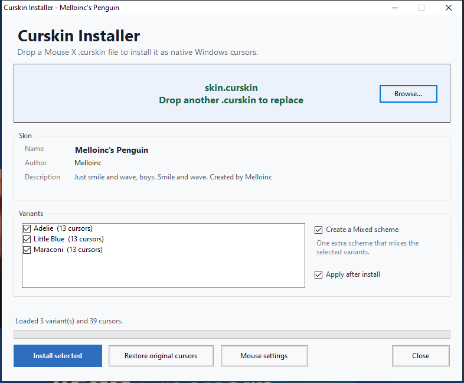

# Curskin Installer


A portable Windows app that installs Mouse X `.curskin` files as native,
per-user Windows cursor schemes. Drag a skin onto the window, pick the variants
you want, and the app converts every cursor to a 32x32 `.cur` or `.ani`,
registers the scheme under `HKCU`, and optionally applies it right away.

No administrator rights. No background service. No telemetry.

[](docs/screenshot.png)

## Highlights

- Drag-and-drop `.curskin` files, with a Browse fallback.
- Converts GIF, PNG, AVIF/AVIS, direct SVG, and layered SVG cursors.
- Keeps hotspots and animation timing; 32x32 output with nearest-neighbor scaling.
- Installs all 17 Windows cursor roles for each variant, with sensible fallbacks.
- Optional **Mixed** scheme that rotates roles across selected variants.
- Applies the scheme immediately, backs up your previous cursor state, and can restore it.
- Per-user only: writes to `HKCU` and `%LOCALAPPDATA%`; never writes to `C:\Windows`.
- Self-contained: the official `avifdec` and `resvg` helpers are embedded and
  extracted on first use.

## Download

Download the latest `CurskinInstaller.exe` or the packaged zip from the
[Releases](../../releases) page.

The app is portable: put the exe anywhere and run it. It is currently unsigned,
so Windows SmartScreen may ask for confirmation.

## Quick start

1. Run `CurskinInstaller.exe`.
2. Drag a `.curskin` file onto the window, or click **Browse**.
3. Select the variants you want. With two or more selected, you can also create
   a **Mixed** scheme.
4. Leave **Apply after install** checked if you want the new cursors applied
   immediately.
5. Click **Install selected**.

Each selected variant becomes a Windows scheme named
`<Skin name> - <Variant name>`. The optional Mixed scheme is
`<Skin name> - Mixed`.

The success dialog shows the installed scheme names, the scheme that was
applied, and the install folder. The schemes also show up in
**Settings > Bluetooth & devices > Mouse > Additional mouse settings > Pointers**
or the app's **Mouse settings** button.

> **Mouse X note:** Mouse X can draw its own cursor over the Windows cursor.
> Quit Mouse X, including its tray process, to see the installed Windows cursor
> on the desktop. The app warns you when it detects the Mouse X process.

## Supported formats

| Source | Notes |
| --- | --- |
| GIF | Animated or still; frame delays are preserved. |
| PNG | Static. |
| AVIF / AVIS | Animated AVIF is decoded frame by frame. |
| SVG | Direct SVG cursors. |
| Layered SVG | Layers are composited bottom-to-top, with masks and transparency. |

Each cursor becomes a 32x32 `.cur` or `.ani`. Bitmap images are scaled with
nearest-neighbor sampling. Frames without timing use 10 FPS (100 ms).

`.curskin` is not publicly documented; the reader covers the field layout used
by current Mouse X skins and ignores unknown fields. Unknown image formats are
not silently guessed; the installer reports a conversion error instead.

## What gets installed

| Item | Location |
| --- | --- |
| Cursor files | `%LOCALAPPDATA%\Microsoft\Windows\Cursors\<SkinName>\` |
| Scheme registration | `HKEY_CURRENT_USER\Control Panel\Cursors\Schemes` |
| Current cursor selection | `HKEY_CURRENT_USER\Control Panel\Cursors` |
| Original cursor backup | `%LOCALAPPDATA%\CurskinInstaller\original-cursors.txt` |
| Extracted helper tools | `%LOCALAPPDATA%\CurskinInstaller\tools\` |

Everything is per-user. The app requests `asInvoker` and does not need
administrator rights. The source `.curskin` file is never modified.

## Mixed schemes

When two or more variants are selected, **Create a Mixed scheme** adds one
extra scheme that assigns the 17 cursor roles round-robin across the selected
variants. For example, the Arrow might come from variant A while the I-beam
comes from variant B. The Mixed scheme reuses the variant files; it does not
create duplicate cursors. The option is disabled for a single variant.

## Restore and uninstall

The first time the app applies a scheme, it saves your current cursor settings
to `%LOCALAPPDATA%\CurskinInstaller\original-cursors.txt`. Click **Restore
original cursors** to put them back. The backup is not overwritten by later
installs; delete the file if you want a new baseline.

Restoring does not remove installed schemes. To remove a scheme, delete its
folder under `%LOCALAPPDATA%\Microsoft\Windows\Cursors\` and its value under
`HKEY_CURRENT_USER\Control Panel\Cursors\Schemes`.

The app itself is portable; delete `CurskinInstaller.exe` to remove it. You can
also delete `%LOCALAPPDATA%\CurskinInstaller\` after removing any schemes you no
longer want.

## Build from source

Requirements:

- 64-bit Windows 10 or 11
- .NET Framework 4.x (Windows includes the in-box C# compiler)
- Optional: Visual Studio 2022 with the **.NET desktop development** workload
  for the solution
- No NuGet packages required

### Command-line build

From a Command Prompt in the project folder:

```bat
build.cmd
```

This produces `CurskinInstaller.exe` in the project folder, with the two
compressed helper binaries embedded as resources. The build is dependency-free
and uses the in-box .NET Framework compiler; it is the build used by
`package.ps1` and CI.

To build a release zip:

```powershell
powershell -ExecutionPolicy Bypass -File package.ps1 -Version 1.0.0
```

The zip is written to `dist\CurskinInstaller-1.0.0-win64.zip`.

### Visual Studio 2022

Open `CurskinInstaller.sln` and press **F5** (or build the solution). The
project targets .NET Framework 4.8 and uses the same source files and embedded
resources as `build.cmd`. The included `.vsconfig` lists the required workload
and targeting pack, so Visual Studio can offer to install them when you open
the solution. If Visual Studio still reports that the targeting pack is
missing, install the **.NET desktop development** workload (or the .NET
Framework 4.8 targeting pack) from the Visual Studio Installer. Build output
goes to `bin\Debug\` or `bin\Release\`.

### Project layout

| Path | Purpose |
| --- | --- |
| `Core.cs` | `.curskin` parser, data model, CLI entry point |
| `CursorBuilder.cs` | GIF/PNG/AVIF/AVIS/SVG to `.cur`/`.ani` conversion |
| `Installer.cs` | Scheme registration, apply, backup, restore |
| `ExternalTools.cs` | Embedded helper extraction and process runner |
| `MainForm.cs` | WinForms drag-and-drop UI |
| `CurskinInstaller.sln`, `CurskinInstaller.csproj` | Visual Studio 2022 solution and project |
| `.vsconfig` | Visual Studio workload and targeting-pack requirements |
| `Properties/AssemblyInfo.cs` | Assembly identity and version metadata |
| `build.cmd` | In-box C# build used for releases |
| `package.ps1` | Release zip packaging |
| `avifdec.exe.gz`, `resvg.exe.gz` | Compressed embedded helpers |
| `app.manifest` | Application manifest |
| `README.txt`, `THIRD-PARTY-NOTICES.txt`, `LICENSE` | Files shipped with the exe |
| `README.md`, `CHANGELOG.md`, `CONTRIBUTING.md` | Repository documentation |
| `docs/screenshot.png` | README screenshot |
| `.github/workflows/build.yml` | CI build and artifact upload |

## How it works

1. The parser reads the protobuf-style `.curskin` structure: variants, cursor
   roles, image bytes, hotspots, and optional SVG layers.
2. The builder rasterizes each cursor at 32x32. AVIF/AVIS is decoded with
   `avifdec`; SVG and layered SVG are rendered with `resvg`.
3. The installer writes `.cur`/`.ani` files, registers the scheme under
   `HKCU`, and applies it with `SystemParametersInfo(SPI_SETCURSORS)`.
4. The GUI is a single WinForms window with drag-and-drop and variant
   selection.

The helpers are embedded as gzip-compressed resources and extracted only when
a skin needs AVIF or SVG support. No network access is used.

## Testing

Tested on 64-bit Windows 11 against six real Mouse X workshop skins covering
GIF, PNG, AVIF/AVIS, direct SVG, and layered SVG. All generated cursor files
loaded through `LoadCursorFromFile` with zero failures; hotspots and animation
rates were checked against the source. The GUI install, scheme registration,
apply, backup, and restore paths were exercised end to end. The positional
scheme order (Pin before Person) and the applied Person/Pin values were also
verified.

There is no automated test harness in the repository yet; the checks above were
manual. Bug reports with a sample `.curskin` file are welcome.

## Limitations

- Windows-only, 64-bit (the embedded helper binaries are x64).
- Cursors are rendered at 32x32; larger Windows cursor sizes are scaled by
  Windows.
- Mouse X can overlay its own cursor; quit it to see the native result.
- The app is unsigned, so SmartScreen may prompt on first run.
- Unknown image formats fail with a conversion error rather than being guessed.

## Privacy

Curskin Installer does not use the network, send telemetry, or download
anything. The AVIF/SVG helpers are embedded in the executable and extracted
locally.

## Third-party components

The app embeds unmodified helper executables from libavif and resvg. Full
versions, licenses, and source links are in
[`THIRD-PARTY-NOTICES.txt`](THIRD-PARTY-NOTICES.txt). The app's own code is
MIT-licensed; see [`LICENSE`](LICENSE).

## Disclaimer

This is an unofficial community tool. It is not affiliated with Mouse X,
Steam, or the authors of the cursor skins you install. Install skins you have
the right to use.

## Contributing

Issues and pull requests are welcome. Please keep the code compatible with the
in-box .NET Framework compiler used by `build.cmd`; the Visual Studio project
targets .NET Framework 4.8. Run `build.cmd` before opening a PR, and avoid
committing `CurskinInstaller.exe`, `bin/`, `obj/`, `dist/`, or extracted helper
binaries.

By contributing, you agree that your contributions are licensed under the MIT
License.
